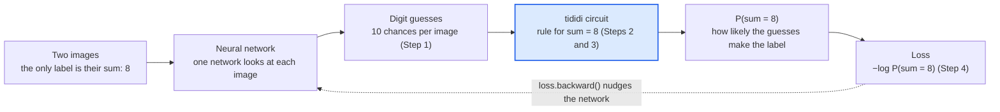
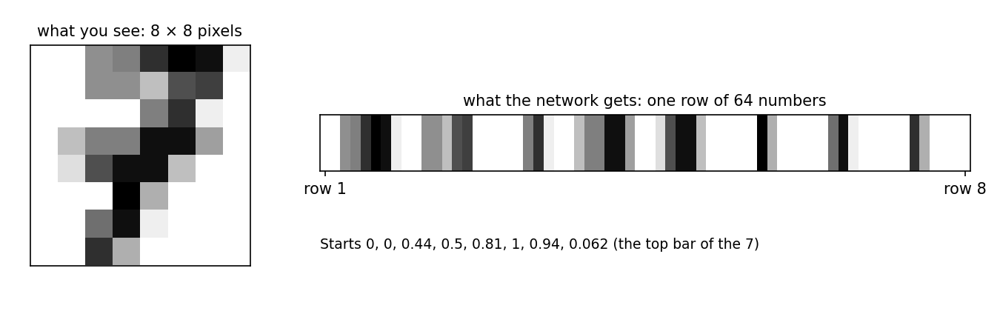
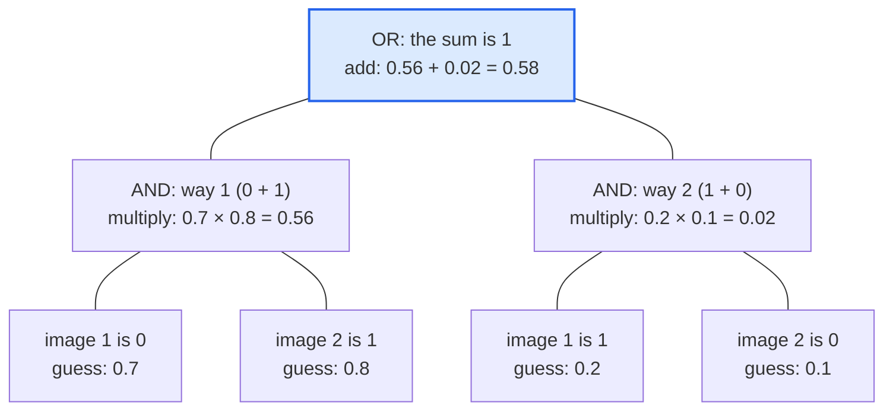
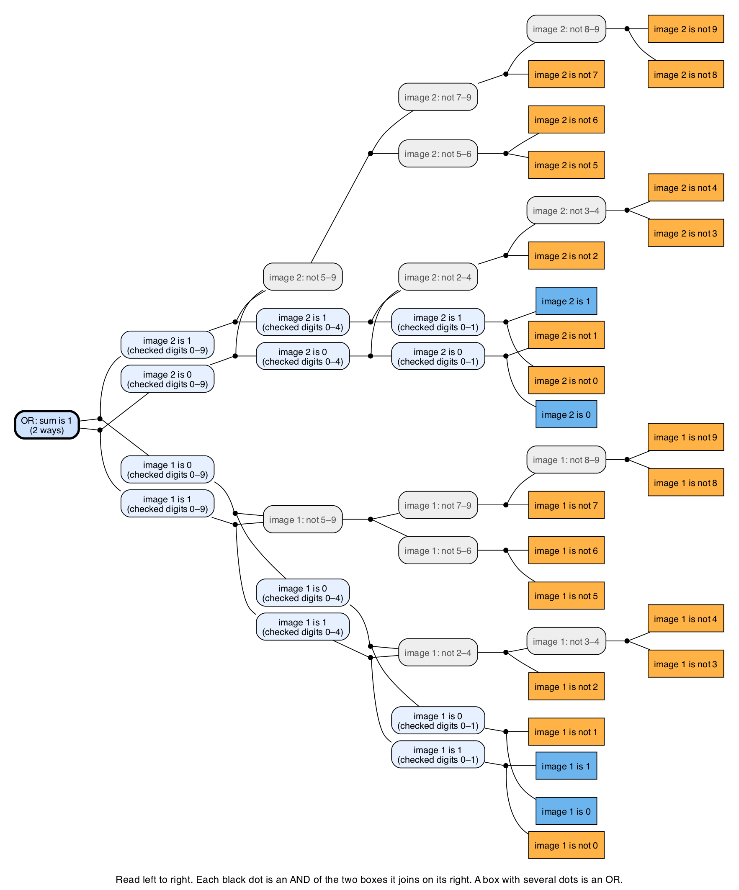
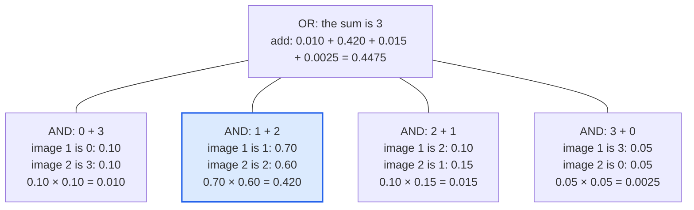
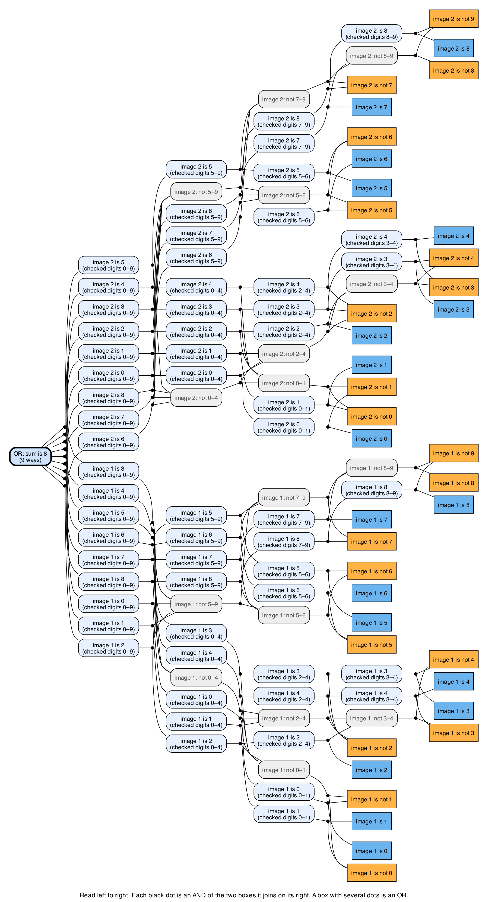

# How the digit-addition example works

This explains [`scripts/deepproblog_addition.py`](../scripts/deepproblog_addition.py), which trains a network to read handwritten digits from their sums alone, with tididi as the circuit. The notebook [`notebooks/digit_addition.ipynb`](../notebooks/digit_addition.ipynb) solves the same problem four ways, side by side.

## The big idea in one picture

A neural network guesses what digit each image shows. A logic circuit built with tididi works out how likely those guesses make the known sum. That likelihood is fed back to improve the network, so it learns digits without ever being told one.



The network is ordinary PyTorch. The highlighted box is the only part tididi does: it holds the rule "digit 1 + digit 2 = sum" and turns guesses into one probability. The dashed arrow is learning.

## What the images are

The images are real handwritten digits from scikit-learn's digits dataset: 1,797 of them, each 8 × 8 pixels. They ship inside the scikit-learn package, so nothing is downloaded.

The network doesn't see a picture. It gets the 64 pixel brightnesses as one list of numbers, read row by row like text. Here is one of the dataset's 7s both ways (darker means more ink):



Every 7 in the dataset is written a little differently, so the network has to learn the shape (a bar at the top, a stroke going down-left) rather than memorise one picture. The script puts 1,300 images aside for training and keeps the other 497 for testing, so test pairs only use images the network has never seen.

## Step 1: the network guesses each digit

The network looks at one image and gives ten numbers: how likely it thinks the image is a 0, a 1, and so on up to 9. The ten numbers always add up to 1 (that is what the softmax at the end does).

The same network looks at both images. For one training example it might say (example numbers, before any training has happened):

| Digit | 0 | 1 | 2–9 together |
| --- | --- | --- | --- |
| Image 1 | 0.7 | 0.2 | 0.1 |
| Image 2 | 0.1 | 0.8 | 0.1 |

These are only guesses. Nobody ever tells the network whether they are right, because the training data has no digit labels. It only has the sum.

## Step 2: the rule becomes a circuit

The rule "digit 1 + digit 2 = sum" is turned into a circuit once, before training starts. tididi only understands yes/no switches, so each image gets ten of them: "image 1 is a 0", "image 1 is a 1", and so on, 20 switches in total.

Two rules come with the switches:

- **Exactly one switch per image is on.** An image can't be a 3 and a 5 at once.
- **For each possible sum, list the ways to make it.** A sum of 1 has two ways: 0 + 1 or 1 + 0. A sum of 8 has nine.

The script builds one circuit for each sum from 0 to 18, which makes 19 circuits. Here is the smallest interesting one, for a sum of 1, read from the bottom up:



Built into every circuit: each image shows exactly one digit, so all other switches score 1.

OR nodes list the ways; AND nodes say both things must be true. Building these 19 circuits is the slow, logical part, and it happens only once. During training only the guesses at the bottom change.

The picture shows the circuit's logic. Inside, tididi stores it more compactly: it groups image 1's switches on one side and image 2's on the other (its *vtree*) and shares repeated pieces. The number it computes is the same.

### The real circuit for sum = 1

This is the circuit tididi actually built, exported with `to_dot()` and drawn with Graphviz. Each node's wording was added afterwards to say what it means.



How to read it:

- **Left edge:** the OR, "sum is 1". Its two black dots are the two ways. The upper dot joins "image 2 is 1" with "image 1 is 0"; the lower one joins "image 2 is 0" with "image 1 is 1".
- **Top half:** image 2's ten switches. **Bottom half:** image 1's. That is the vtree split: tididi never mixes the two images below the root.
- **Blue boxes** are the switches that must be on, such as "image 1 is 0". **Orange boxes** must be off. **Grey boxes** such as "image 2: not 5–9" bundle the "all other digits are off" part of the exactly-one rule.
- **Each box is checked in halves.** "image 2 is 1 (checked digits 0–9)" splits into a check over digits 0–4 and a grey "not 5–9". The 0–4 check splits again, down to single switches on the right.
- **Sharing:** both ways use the same grey box "image 2: not 5–9", stored once. That sharing is why the circuit stays small (60 pairs).

To evaluate it, tididi starts at the right-hand leaves (guess p for blue, 1 for orange), multiplies at every dot and adds at the OR on the left. That gives the 0.7 × 0.8 + 0.2 × 0.1 = 0.58 from the simplified picture above.

## Step 3: the circuit turns guesses into P(sum)

With the guesses from Step 1, the circuit for "the sum is 1" gives **0.58**. It gets there with nothing but multiplying and adding:

1. **AND means multiply.** "Image 1 is 0 and image 2 is 1" scores 0.7 × 0.8 = 0.56. The two images are independent, so their chances multiply.
2. **OR means add.** "Image 1 is 1 and image 2 is 0" scores 0.2 × 0.1 = 0.02. Either way gives a sum of 1, and the two ways can't both happen, so their scores add: 0.56 + 0.02 = 0.58.
3. **Everything else counts as 1.** A "not this digit" literal scores 1, so the eight other digits of each image don't change the product. The exactly-one rule already guarantees they are off.

In general:

```math
P(\text{sum} = s) = \sum_{a + b = s} P(\text{image 1} = a) \cdot P(\text{image 2} = b)
```

tididi does the walking: it visits the circuit's pieces from the bottom up and asks the script's `TorchProbability` class four questions (what is a leaf worth, what is impossible worth, how to combine with AND, how to combine with OR). The class answers with PyTorch numbers, so tididi never needs to know it is doing probability.

### A middle sum: 3

A sum of 3 can be made four ways: 0 + 3, 1 + 2, 2 + 1 and 3 + 0. Say the images are really a 1 and a 2, and the network is fairly sure of both:



As before, every other switch scores 1 because of the exactly-one rule, so it doesn't change any product.

P(sum = 3) is 0.4475, and the right way (1 + 2) supplies 0.42 of it. tididi's exact calculation on these guesses gives the same 179/400 = 0.4475; its real circuit for sum 3 has 72 pairs, between sum 1 (60) and sum 8 (91).

### A bigger sum: 8

The same rule scales up. Say the two images are really a 3 and a 5, so the label is 8. A sum of 8 can be made **nine** ways, and the circuit scores every one with the network's current guesses (example numbers, partway through training):

| Way (image 1 + image 2) | Guess image 1 | Guess image 2 | Multiply |
| --- | --- | --- | --- |
| 0 + 8 | 0.01 | 0.03 | 0.0003 |
| 1 + 7 | 0.01 | 0.01 | 0.0001 |
| 2 + 6 | 0.02 | 0.05 | 0.0010 |
| **3 + 5** | **0.60** | **0.70** | **0.4200** |
| 4 + 4 | 0.02 | 0.01 | 0.0002 |
| 5 + 3 | 0.10 | 0.15 | 0.0150 |
| 6 + 2 | 0.02 | 0.01 | 0.0002 |
| 7 + 1 | 0.01 | 0.01 | 0.0001 |
| 8 + 0 | 0.20 | 0.01 | 0.0020 |
| **Add them all: P(sum = 8)** |  |  | **0.4389** |

What this shows:

- **One way does almost all the work.** 3 + 5 gives 0.42 of the 0.4389, because the network already leans towards the right digits. Ways it thinks are unlikely add almost nothing.
- **Wrong-but-plausible ways still count.** 5 + 3 adds 0.015, because the network gives image 1 a small chance of being a 5. Training pushes mostly on 3 + 5, the biggest term, and so sharpens the right answer.
- **The loss is higher than for the sum-1 example:** −log(0.4389) ≈ 0.82, against 0.54 there. The network is less sure here, so it gets a bigger push.
- **The circuit is still small.** tididi stores the sum-8 circuit in 91 pairs, against 60 for sum 1. Running tididi's exact calculation on these guesses gives 4389/10000, the same 0.4389.

The real sum-8 circuit, drawn the same way. Its OR on the left has **nine** dots, one per way. Each dot joins an "image 2 is b" box with an "image 1 is 8 − b" box; the lines cross a lot, so the pairing is easier to follow in the table above.



The same grey "not" boxes are shared by many ways, so nine ways cost only 91 pairs.

## Step 4: learning from the answer

If the true sum was 1, the network gave the right answer a 58% chance, and training pushes that number up. The score it minimises is the **loss**, −log P(true sum): −log(0.58) ≈ 0.54. A perfect guess (P = 1) would give a loss of 0.

PyTorch records every multiply and add the circuit asked for. When the script calls `loss.backward()`, PyTorch runs that record backwards and works out, for every weight inside the network, which direction makes 0.58 bigger. In this example it would nudge the network towards:

- image 1 being a 0 (it is part of the biggest term, 0.7 × 0.8);
- image 2 being a 1 (same term);
- away from the digits 2–9 for both images, because no way of making a sum of 1 uses them.

The network is never told "this is a 0". It only learns which guesses make the observed sums likely. Repeat that over 3,000 examples and five passes (epochs), and the guesses become digit recognition.

## Why sums alone are enough

Some sums give the answer away completely, and the rest follows from them like a sudoku.

| Sum seen | Possible digit pairs | What it teaches |
| --- | --- | --- |
| 0 | 0+0 | Both images are 0: what a 0 looks like |
| 18 | 9+9 | Both images are 9: what a 9 looks like |
| 1 | 0+1, 1+0 | Once 0 is known, the other image is a 1 |
| 17 | 8+9, 9+8 | Once 9 is known, the other image is an 8 |
| 9 | 10 different pairs | Little on its own; useful once most digits are known |

At the end of each epoch the script prints two accuracies on 1,000 test pairs. **Sum accuracy** is how often the circuit's most likely sum is right. **Digit accuracy** checks the network's guess for each single image against the true digit, which the script kept aside and never trained on. A high digit accuracy is the proof that the network learned digits from sums alone.

A test run on 2026-10-06 took about 30 seconds. After five epochs the network read **95.4%** of single test digits correctly and got **90.9%** of sums right, without ever seeing a digit label. Sum accuracy is lower because both digits must be right.

## Where each idea lives in the code

All in [`scripts/deepproblog_addition.py`](../scripts/deepproblog_addition.py).

| Idea | Code | Line |
| --- | --- | --- |
| Ten yes/no switches per image | [`var(slot, digit)`](../scripts/deepproblog_addition.py#L41) | 41 |
| Exactly one switch on | [`exactly_one`](../scripts/deepproblog_addition.py#L46) | 46 |
| One circuit per possible sum, built once | [`compile_queries`](../scripts/deepproblog_addition.py#L54) | 54 |
| AND = multiply, OR = add, "not" = 1 | [`TorchProbability`](../scripts/deepproblog_addition.py#L70) | 70 |
| P(sum = s) for every s | [`sum_probabilities`](../scripts/deepproblog_addition.py#L100) | 100 |
| Self-test against tididi's exact fractions | [`check_against_exact`](../scripts/deepproblog_addition.py#L106) | 106 |
| Real handwritten digits, paired at random | [`load_digit_images`](../scripts/deepproblog_addition.py#L124), [`make_pairs`](../scripts/deepproblog_addition.py#L132) | 124, 132 |
| Network guesses digits | [`net`](../scripts/deepproblog_addition.py#L156), [`digit_probs`](../scripts/deepproblog_addition.py#L159) | 156, 159 |
| Loss and learning | [`loss = −log P(true sum)`](../scripts/deepproblog_addition.py#L169), `loss.backward()` | 169 |
| Sum and digit accuracy | [`sum_acc`, `digit_acc`](../scripts/deepproblog_addition.py#L178) | 178, 179 |

## Glossary

- **Circuit:** a compiled form of a logic rule that makes "how likely is this rule to be true" a quick multiply-and-add job.
- **tididi:** the Rust library (with a Python wrapper) that builds and evaluates these circuits. Its kind of circuit is a Tree Decision Diagram.
- **vtree:** the tree that tells tididi how to group the switches. Here: image 1's ten on one side, image 2's ten on the other.
- **Loss:** the number training tries to shrink; here −log P(true sum).
- **Gradient / backward:** PyTorch's way of working out which way to nudge each network weight to shrink the loss.
- **Epoch:** one pass over all 3,000 training pairs.
- **DeepProbLog:** a system that does exactly this pattern automatically from a logic program; this script does it by hand with tididi.
