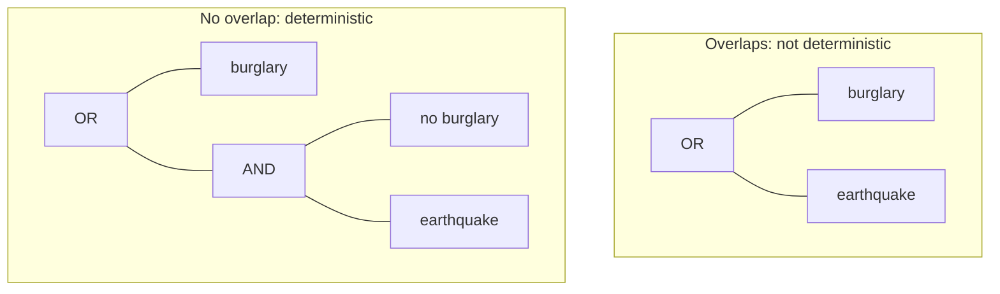

# Learning guide: from ProbLog to probabilistic circuits

This guide takes you from two school probability rules to checking a real tididi circuit yourself, in seven steps. Each step explains one idea, then gives exercises. Answer each exercise on paper first, then run the matching cell in the notebook to check yourself. Worked answers are in the last section.

## How to use this guide

**The notebook** is [`notebooks/learning_guide.ipynb`](../notebooks/learning_guide.ipynb). Its cells are labelled with the same exercise numbers as this guide (1a, 2b, …). Steps 1–5 use plain Python. Steps 6–7 need `torch` and `tididi`. Set up this repo's environment as the [README](../README.md) describes, then from the repo root:

```sh
source .venv/bin/activate
jupyter lab notebooks/learning_guide.ipynb
```

Run the cells from top to bottom, because later steps reuse functions from earlier ones.

**The one tool to take away** is the brute-force checker in Step 2. It lists every possible world and adds up probabilities directly. It is slow, but short enough to check by reading. Every later answer, whether by hand, by circuit or by tididi, is checked against it. That's how you'll be able to verify anything built on top of this.

## Step 1: the two probability rules

Everything in this guide, including every circuit, uses only two rules:

| Rule | When it applies | Example |
| --- | --- | --- |
| **Multiply** | The things are **independent**: one tells you nothing about the other | Two coins both land heads: ½ × ½ = ¼ |
| **Add** | The things **can't happen together** | A die shows 1 or 2: 1/6 + 1/6 = 1/3 |

The second rule has a trap. If the things *can* happen together, adding counts the overlap twice. That trap comes back in Step 4 as the reason circuits need a special shape.

**Exercises**

- **1a.** Two fair coins. What is the chance both land heads?
- **1b.** One fair die. What is the chance it shows a 1 or a 2?
- **1c.** Two fair coins. What is the chance of *at least one* head? Why does ½ + ½ give the wrong answer, and what is the right one?

## Step 2: ProbLog and possible worlds

A ProbLog program is ordinary logic plus facts that are only *probably* true:

```prolog
0.1::burglary.        % true with chance 0.1
0.2::earthquake.      % true with chance 0.2, independently
alarm :- burglary.    % the alarm goes off if there's a burglary
alarm :- earthquake.  % ... or an earthquake
query(alarm).         % how likely is the alarm?
```

What it means: every uncertain fact is either true or false, and each combination is a **possible world**. A world's chance is its facts' chances multiplied (Step 1), using 1 − p for a fact that is false. The rules (`:-`, read "if") are not uncertain: in each world they just decide whether `alarm` is true. P(alarm) is the sum of the worlds where it is.

The possible worlds for the burglary program:

| World | burglary | earthquake | Chance (multiply) | alarm? |
| --- | --- | --- | --- | --- |
| 1 | no | no | 0.9 × 0.8 | no |
| 2 | no | yes | 0.9 × 0.2 | **yes** |
| 3 | yes | no | 0.1 × 0.8 | **yes** |
| 4 | yes | yes | 0.1 × 0.2 | **yes** |

P(alarm) = the chances of worlds 2, 3 and 4 added up.

Worlds can't happen together (exactly one world is the real one), so adding them is safe. This is the **brute-force checker**: in the notebook it is two functions, `worlds` and `prob`, about 15 lines. Read them; they should look obviously right to you.

**Exercises**

- **2a.** Write out the four worlds and their chances yourself, then P(alarm). Check the four chances add up to 1.
- **2b.** Add `0.5::hears_alarm.` and `calls :- alarm, hears_alarm.` (the comma means *and*). How many worlds are there now? What is P(calls)?
- **2c.** You learn the alarm went off. How likely is a burglary now? Use P(burglary | alarm) = P(burglary and alarm) / P(alarm), and look at the worlds: which ones have both?
- **2d (optional).** Paste the program into ProbLog's online editor on the ProbLog website, or run the notebook's ProbLog cell. Do you get the same number as 2a?

## Step 3: exactly-one choices (annotated disjunctions)

Some uncertain things are a choice among options, not a yes/no fact. An image shows exactly one digit. ProbLog writes this with semicolons:

```prolog
0.7::digit(img1, 0); 0.2::digit(img1, 1); 0.1::digit(img1, 2).
```

This is an **annotated disjunction**: exactly one option is true, and the chances add up to 1. With two such images, a world is one pick per image, and its chance is the two picks multiplied. To keep the worlds few, the notebook's images can only be 0, 1 or 2, so there are 3 × 3 = 9 worlds.

**The switch encoding.** Circuit libraries such as tididi only know yes/no variables. So each option becomes its own **switch** ("image 1 is a 0", "image 1 is a 1", …), plus a rule that exactly one switch per image is on. Each switch gets two **weights**: its chance p when on, and 1 when off. Under the exactly-one rule, each allowed setting then weighs exactly its world's chance. This is the encoding the addition example uses.

**Exercises** (image 1: 0.7 / 0.2 / 0.1 for digits 0 / 1 / 2; image 2: 0.1 / 0.8 / 0.1)

- **3a.** List the 9 worlds with their chances. Then work out P(sum = s) for s = 0 to 4. Which sum is most likely, and do the five add up to 1?
- **3b.** Using the switch encoding, compute P(sum = 1). It must equal your 3a answer. Which switch settings count, and why do the off switches not change anything?
- **3c.** Now let an off switch weigh 1 − p, as an ordinary fact would. Run the cell. Is the answer still right? Why not?
- **3d.** Keep the good weights but drop the exactly-one rule. Run the cell. What goes wrong?

## Step 4: why circuits

Listing worlds doubles with every fact: 2 facts make 4 worlds, 20 make about a million, and 300 make more worlds than there are atoms in the universe. A **circuit** gets the same answer in one pass, without listing worlds. It is a tree (or shared graph) of AND and OR nodes over the facts. Each fact gets its chance, and the circuit **multiplies at every AND and adds at every OR**.

Those are Step 1's two rules, so the circuit is only right when they apply:

- **Decomposable:** the two sides of every AND are about different facts, so they are independent and multiplying is safe.
- **Deterministic:** the two sides of every OR can never both be true, so adding never counts anything twice.

The obvious circuit for `alarm` breaks the second rule. Rewriting it as "burglary, OR (no burglary AND earthquake)" fixes it, and gives the same rule with no overlap:



On the left, both sides of the OR are true in the world where both happen, so adding counts that world twice. On the right, the two sides of the OR can never both be true.

This is the whole job of a circuit library such as tididi: build circuits that keep both properties, and keep them small. The notebook's `decomposable` and `deterministic` functions check the two properties by brute force.

**Exercises**

- **4a.** Evaluate the circuit "burglary OR earthquake" by hand (multiply at AND, add at OR). Which property does it break, and by how much is the answer off?
- **4b.** Evaluate "burglary OR (no burglary AND earthquake)". Check both properties hold.
- **4c.** What does the circuit "burglary AND burglary" give? What should it give, and which property is broken?
- **4d.** How many worlds would the addition example have if you listed every setting of its 20 switches? (No notebook cell; just Step 1.)

## Step 5: weighted model counting

**Weighted model counting** (WMC) is the general name for what Steps 2–4 did. Give every variable two weights, one for off and one for on. A **model** is a setting of all the variables that makes the formula true. The WMC is the sum, over all models, of the product of the variables' weights:

```math
\text{WMC}(\text{formula}) = \sum_{\text{models}} \; \prod_{\text{variables } v} \text{weight}(v \text{ as set in that model})
```

- With weights (1 − p, p), WMC is exactly the probability from Step 2.
- With weights (1, p) and an exactly-one rule, it is the probability from Step 3.
- With every weight 1, it just counts the models. That's tididi's `model_count`.

There are two ways to compute it:

| Way | How | Speed | Notebook |
| --- | --- | --- | --- |
| Brute force | Try every setting of every variable | Doubles with each variable | `wmc` |
| Circuit | One pass, multiplying at AND, adding at OR | Grows with the circuit's size | `evaluate` |

For a decomposable, deterministic circuit, the two always agree. That's the check you can run on any circuit: compare it with brute force on small cases.

**One catch: variables a branch doesn't mention.** In the fixed alarm circuit, the left branch is just "burglary". Earthquake can be on or off there, so it should count as weight(off) + weight(on). With probabilities that is (1 − p) + p = 1, so leaving it out changes nothing. With Step 3's (1, p) weights it is 1 + p, which is not 1. A circuit library must handle this, and tididi does: a variable left free counts as weight(off) + weight(on). That's the `1 + p` in the addition example's `leaf(v, None)`.

**Exercises**

- **5a.** Compute the fixed alarm circuit both ways, `evaluate` and `wmc`. Do they agree?
- **5b (harder).** The circuit is just "x", over the variables x and y, with weights x: (1, 0.3) and y: (1, 0.6). What does `evaluate` give, and what does `wmc` give? Explain the difference using the catch above, and say what factor fixes it.

## Step 6: DeepProbLog

DeepProbLog changes one thing: some chances come from a **neural network** instead of being written in the program.

```prolog
nn(digit_net, [X], D, [0, 1, 2]) :: digit(X, D).          % the network gives the chances
addition(X, Y, S) :- digit(X, A), digit(Y, B), S is A + B.
```

The first line is an annotated disjunction (Step 3) whose chances are the network's output for image X. Everything else stays the same: the query becomes a circuit (Step 4), and the circuit computes P(query) (Step 5).

**Learning.** Training data gives only the answer, for example "these two images sum to 1". The loss is −log P(sum = 1). Because a circuit is nothing but multiplications and additions, PyTorch can work out how each network output should change to raise P(sum = 1), and the network is nudged that way. Nobody tells it what each digit is.

In the notebook, each network is reduced to its raw outputs (**logits**: three numbers per image, turned into chances by softmax), so you can watch one training step happen. [How the digit-addition example works](digit-addition-explained.md) does the same at full size, with real images.

**Exercises**

- **6a.** Image 1's logits favour 0 and image 2's favour 1. Before running the cell, predict: will the gradient tell image 1's "0" logit to go up or down? Image 2's "1" logit? Why do the others go the opposite way? (In PyTorch, a negative gradient means "increase this to lower the loss".)
- **6b.** Take one step against the gradient. Does P(sum = 1) go up? By roughly how much?
- **6c (think).** If the label were "sum = 4", which logits would get pushed up? Use the circuit for sum 4 with digits 0–2 only.

## Step 7: tididi, and checking a circuit yourself

tididi builds decomposable, deterministic circuits for you. You never arrange ANDs and ORs by hand; you combine simple pieces and tididi keeps both properties:

| You write | Means |
| --- | --- |
| `tididi.literal(vtree, 3)` / `literal(vtree, -3)` | variable 3 is on / off |
| `a \| b`, `a & b`, `~a` | OR, AND, NOT of two circuits |
| `c.weighted_count({v: (off, on), …})` | Step 5's WMC, exact, with fractions |
| `c.model_count()` | number of models (every weight 1) |
| `a.equivalent(b)` | are two circuits the same rule? |

The **vtree** tells tididi how to group the variables. For now, `Vtree.balanced(n)` is fine; it matters for size, never for the answer.

One habit is worth keeping: operations like `&` **use up** their inputs, so call `.copy()` on a circuit you still need.

**The checking pattern.** Exercise 7d is the one to remember. It takes the addition example's 19 circuits, gives every digit a random chance, and checks each circuit against the possible-worlds answer from Step 3, exactly. This is how you can check anything built later, including an automatic ProbLog-to-tididi compiler: same inputs, compare with brute force on small cases, exact fractions, no rounding.

**Exercises**

- **7a.** Build `alarm` as a tididi circuit and get its weighted count. Same as 2a? How many models does it have, and which are they?
- **7b.** Build `calls` (variable 3 = hears_alarm). Same as 2b?
- **7c.** "b OR e" and "NOT (NOT b AND NOT e)" look different. Are they the same rule? Check with `equivalent`, then say why in one sentence.
- **7d.** Run the check of all 19 addition circuits. Then break the example on purpose: in [`scripts/deepproblog_addition.py`](../scripts/deepproblog_addition.py), delete `& domain.copy()` and run again. Which step of this guide explains what you see? (Undo it afterwards.)

## Answers

All numbers below are what the notebook prints; it uses exact fractions.

**Step 1**

- **1a.** ½ × ½ = **1/4**.
- **1b.** 1/6 + 1/6 = **1/3**.
- **1c.** **3/4**. ½ + ½ = 1 is wrong because "both heads" (chance 1/4) is counted in both halves. Right: 1 − P(no heads) = 1 − ¼.

**Step 2**

- **2a.** Worlds: neither 0.72, earthquake only 0.18, burglary only 0.08, both 0.02 (total 1). P(alarm) = 0.18 + 0.08 + 0.02 = **0.28**.
- **2b.** 2 × 2 × 2 = 8 worlds. P(calls) = **0.14**: 0.28 × 0.5, because hearing is independent of the alarm.
- **2c.** The worlds with both burglary and alarm are "burglary only" and "both": 0.08 + 0.02 = 0.10. P(burglary | alarm) = 0.10 / 0.28 = **5/14 ≈ 0.357**, up from 0.1.
- **2d.** ProbLog prints `{alarm: 0.28}`.

**Step 3**

- **3a.** P(sum = 0..4) = **0.07, 0.58, 0.24, 0.10, 0.01**. Sum 1 is most likely, and the five add up to 1. For example sum 2 = 0.7×0.1 + 0.2×0.8 + 0.1×0.1.
- **3b.** **0.58**, same as 3a. Only two settings count: "image 1 is 0, image 2 is 1" and "image 1 is 1, image 2 is 0", each with every other switch off. The off switches weigh 1, so they leave each product unchanged: 0.7×0.8 + 0.2×0.1.
- **3c.** **≈ 0.3276**, wrong. Each product picks up extra factors (1 − p) for the four off switches. Switches aren't independent coins: once one is on, the others *must* be off, so "off" adds no extra chance and should weigh 1.
- **3d.** **≈ 0.9549**, wrong. Without the rule, impossible settings count too, such as image 1 being a 0 *and* a 1.

**Step 4**

- **4a.** 0.1 + 0.2 = **0.3**. It is not deterministic: both sides are true in the "both" world, so its 0.02 is counted twice (0.3 − 0.28).
- **4b.** 0.1 + 0.9 × 0.2 = **0.28**. Both properties hold.
- **4c.** It gives 0.1 × 0.1 = **0.01**, but "burglary AND burglary" just means burglary: **0.1**. Not decomposable: both sides are about the same fact, so they aren't independent.
- **4d.** 2²⁰ = **1,048,576** settings, of which only 100 obey the exactly-one rule.

**Step 5**

- **5a.** Both give **7/25 = 0.28**.
- **5b.** `evaluate` gives **0.3**, `wmc` gives **0.48**. The circuit never mentions y, so `evaluate` silently drops it. But y is free, both on and off are allowed, so it should count as 1 + 0.6. The fixing factor is **1.6**: 0.3 × 1.6 = 0.48. tididi applies that factor automatically.

**Step 6**

- **6a.** P(sum = 1) ≈ **0.590**. Image 1's gradients are about (−0.26, +0.16, +0.10): its "0" logit should go **up**. Image 2's are (+0.07, −0.16, +0.10): its "1" should go **up**. The others go down because softmax shares one total: raising one chance lowers the rest. Image 1's "1" also appears in the second way (1 + 0), but that way is tiny (0.2 × 0.1), so overall it is pushed down.
- **6b.** Yes: about 0.590 → **0.631** after one step.
- **6c.** With digits 0–2, sum 4 has only one way, 2 + 2. Both images' "2" logits go up, and everything else goes down.

**Step 7**

- **7a.** **7/25 = 0.28**, same as 2a. **3 models:** burglary only, earthquake only, both.
- **7b.** **7/50 = 0.14**, same as 2b.
- **7c.** `True`. "Not (neither)" means "at least one" (De Morgan's law).
- **7d.** All 19 match. Without `& domain.copy()` the check fails at **sum 0**: the other 18 switches are left free and each counts as 1 + p (Step 5's catch), and impossible settings count too (3d). The exactly-one rule is what makes the circuit mean the program.
