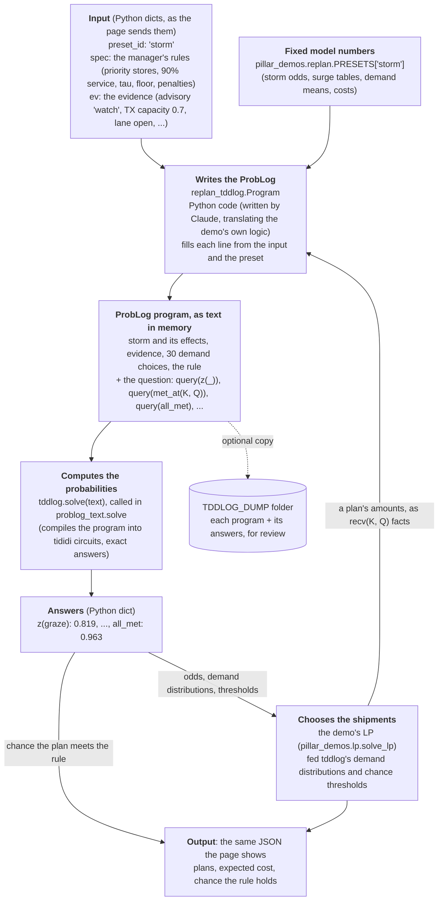

# The PILLAR demos with tddlog

Both demos, and the forecast comparison at the bottom of both pages, written as ProbLog programs, with [tddlog](https://github.com/Tractables/tddlog)
computing every probability. The ported engines in `demos/backend` stay as they are; this
experiment swaps their probability code for tddlog at run time and compares the results with the
golden outputs captured from the original pages.

## How it works

Python code writes the ProbLog program, tddlog computes the probabilities, and the demo's LP
uses them to choose the plan. Replan, step by step:



| Question | Answer |
|---|---|
| What is the input? | For Replan: `preset_id` (toy or storm), `spec` (the manager's rules, as ChatGPT turns them into settings) and `ev` (the evidence), the same three dictionaries the page sends to the engine. In `compare.py` they come from each recorded case in `demos/golden`; `replan_tddlog.py storm` uses the defaults. The fixed numbers of the model come from the demo's `PRESETS` table. |
| Who writes the ProbLog? | Python code in this folder: `Program` in `replan_tddlog.py` (likewise `model` in `copilot_tddlog.py`, `program` in `evaluation_tddlog.py`). Claude wrote that code by translating the demos' own JavaScript logic; it was checked against the original pages' outputs and against ProbLog, but not reviewed by a domain expert. No `.pl` file is read; the program is built as text for each input. |
| Who computes the probabilities? | tddlog, through one call: `tddlog.solve(text)` in `problog_text.solve`. Nothing else computes a probability while `Patched` is active. |
| Who chooses the plan? | The demo's own code, unchanged: the shipment LP (Replan), the LP per subset of worlds (Copilot), the search over stock levels (forecast comparison). They ask tddlog for the probabilities they need. |
| How does the engine use it? | `Patched` swaps the engine's probability functions (`build_model`'s demand distributions, `_chance_threshold`, `_p_rule_met`, `_p_all_met`) for ones that ask tddlog, for the length of a `with` block. The demo code in `demos/` is not edited. |
| How do I see a program? | `python replan_tddlog.py storm` prints the storm program and tddlog's answers; `TDDLOG_DUMP=<folder>` saves every program a run builds; `review_run.py` does that for one scenario of each demo. |

## What is ProbLog, and what stays as it was

| Demo | Written as ProbLog | tddlog answers | Unchanged |
|---|---|---|---|
| Circuit Copilot | the three worlds and their priors, the observed world, the late A to S4 delivery in a storm, a plan's shipments, the priority rule | each world's posterior, each plan's probability that the rule holds, the storm-linked against independent delay | the LP per subset of worlds, the choice among them |
| PILLAR Replan | the storm, and the surge, emergency, advisory, sales, TX capacity and lane status it influences; the operator's evidence; each store and category's five-point demand; the rule with the exception | the posterior and the evidence attribution, each store's demand distribution, the chance thresholds, a plan's probability that each and every priority store meets the rule | the shipment LP, the most-likely-world plan (tddlog has no MPE query), the sampled backtest |
| Forecast comparison | the training days as the demand model: one certain day of means (point forecast), one random day shared by the three stores (joint), or one random day per store (independent); a store covers its demand when stock >= floor x demand | each store's coverage at every candidate stock level, its demand distribution (for the expected shortage), the probability all three cover for every stock combination that can still qualify | the search over stock combinations, the scoring on held-out days |

`programs/*.pl` are example programs for each demo and the forecast comparison, with their queries. They are plain ProbLog,
so `tddlog programs/replan_storm.pl` or ProbLog itself can run them.

## Results

`python compare.py` against `demos/golden`, numbers to a relative 1e-9:

| Suite | Matches |
|---|---|
| Copilot: the page's 38 cases, 60 random cases, minimum backup, independence contrast | all |
| Replan: posterior and evidence attribution (74 cases) | 74/74 |
| Replan: the golden plans scored with tddlog's probabilities | 74/74 |
| Replan: what each plan decides (chance thresholds, expected cost, probability the rule holds, what is relaxed) | 74/74 |
| Replan: the whole output, value for value | 18/74 |
| Forecast comparison: the 36 page runs and 20 random uploaded CSVs, whole output | 56/56 |

The Replan outputs that differ value for value pick a different plan among equally cheap ones.
tddlog's demand distributions agree with the engine's to the last bit or two (5e-17), since
they are sums taken in another order; that is enough to change the simplex's pivot path, and where
the LP has several optimal plans, which one it ends on. The plan's cost and its probability of
meeting the rule are the same, as the decision row shows; the shipments, iteration counts and
capacity values near zero (about 1e-10) are not.

## Reviewing the programs

The code builds each ProbLog program as text and passes it to tddlog; it never reads a `.pl` file.
To see exactly what was built, set `TDDLOG_DUMP=<folder>`: every program sent to tddlog is also
written there, named by the question it asks (`replan-storm-posterior-<hash>.pl`), with tddlog's
answers appended as comments. `review_run.py` does this for one scenario of each demo (Replan's
default storm, Copilot's storm scenario, the forecast comparison at capacity 240) and writes the
26 programs that run builds to `programs/review/`:

| Files | The question |
|---|---|
| `replan-storm-posterior` | odds of the storm, surge and emergency given the evidence |
| `replan-storm-demand` | each store and category's demand distribution |
| `replan-storm-threshold-<store>` | the rule's probability at each candidate amount for that store |
| `replan-storm-plan` | for a plan's amounts, the chance each priority store, and all of them, meet the rule |
| `copilot-storm-worlds`, `copilot-storm-plan` | world odds; a plan's chance that the rule holds |
| `forecast-coverage`, `forecast-joint` | each store's coverage per stock level and its demand; all three covering together |

`programs/*.pl` (outside `review/`) are hand-picked examples written by `export_programs.py`.

## Files

- `problog_text.py`: numbers and names as ProbLog, and the tddlog call.
- `copilot_tddlog.py`, `replan_tddlog.py`, `evaluation_tddlog.py`: each demo's program, its queries, and `Patched`, which
  points the engine's probability functions at tddlog for the length of a `with` block.
  `python replan_tddlog.py storm` (or `toy`) prints the program for the default rules and
  evidence, and tddlog's answers.
- `compare.py`: the comparison above. `export_programs.py`: writes the examples in `programs/`.
  `review_run.py`: writes every program one run builds to `programs/review/`.

## Running

The engines need Python 3.12 (the backend's `uv` environment); tddlog's Python package is built
from the `../tddlog` checkout as a wheel for Python 3.10 and later. On this Mac the C++ headers
need `CXXFLAGS`, because the Command Line Tools carry an incomplete copy that clang reads first:

```sh
cd ../../../tddlog
mkdir -p bindings/python/notices && cp LICENSE NOTICE THIRD-PARTY.md bindings/python/notices/
CXXFLAGS="-isystem $(xcrun --show-sdk-path)/usr/include/c++/v1" RUSTUP_TOOLCHAIN=1.94.0 \
    maturin build --release -m bindings/python/Cargo.toml -o /tmp/tddlog-wheel
cd -
uv run --project ../../demos/backend --with /tmp/tddlog-wheel/tddlog-*.whl python compare.py
uv run --project ../../demos/backend --with /tmp/tddlog-wheel/tddlog-*.whl python export_programs.py
```

`uv run --with` adds tddlog for the run only; the backend's environment is not changed.
